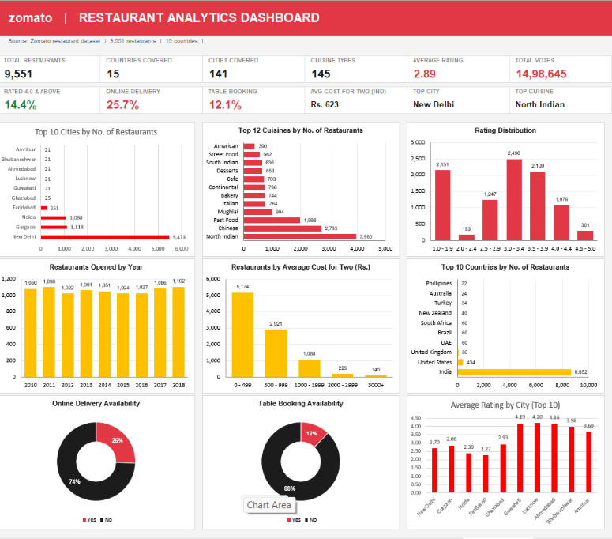

# Zomato Restaurant Data Analysis

## 📌 Project Overview
Comprehensive analysis of 9,500+ Zomato restaurants in Bangalore to uncover trends in ratings, pricing, cuisines, and online ordering.

## 🎯 Objectives

1. Build a Country Map Table
2. Build a Calendar Table using Datekey column - Add all below columns in Calendar Table:

   - A. Year
   - B. Monthno
   - C. Monthfullname
   - D. Quarter (Q1,Q2,Q3,Q4)
   - E. YearMonth (YYYY-MMM)
   - F. Weekdayno
   - G. Weekdayname
   - H. FinancialMonth (April=FM1, May=FM2 .... March=FM12)
   - I. Financial Quarter - APRIL-JUNE:FQ1, JULY-SEP:FQ2, OCT-DEC:FQ3, JAN-MARCH:FQ4

3. Find Numbers of Restaurants based on City and Country
4. Numbers of Restaurants opening based on Year, Quarter, Month
5. Count of Restaurants based on Average Ratings
6. Create buckets based on Average Price and find how many restaurants fall in each bucket
7. Percentage of Restaurants based on "Has_Table_booking"
8. Percentage of Restaurants based on "Has_Online_delivery"
9. Develop Charts based on Cuisines, City, Ratings

## 📊 Dataset
- Rows: 9,500+ Restaurants
- Columns: Restaurant Name, Location, Cuisines, Average Cost, Rating, Votes, Online Order, Table Booking etc.

## 🛠️ Tools Used
- Python: Pandas, NumPy, Matplotlib, Seaborn
- SQL: Data Cleaning, Filtering, Aggregations
- Power BI: Interactive Dashboard with Maps & KPIs
- Excel: Initial Data Exploration
- Tableau: Interactive Dashboard with Maps & KPIs

## 🔍 Key Insights
1. Delhi have highest number of restaurants
2. North Indian, Chinese, South Indian are top 3 cuisines
3. Restaurants with Online Ordering = Yes get 15% more votes
4. Average Cost for 2: Rs. 400 is sweet spot - highest rated
5. 70% restaurants are rated between 3.5 - 4.5

## 📈 Dashboard

## 📂 Files
- 📊 `zomato_dataset.xlsx` - Cleaned Zomato dataset
- 📓 `zomato_queries.sql` - SQL analysis queries
- 📈 `zomato_dashboard.pbix` - Power BI Dashboard
- 📊 `zomato_dashboard_t.twbx` - Tableau Dashboard

## 👤 Author
**Mohammad Sameer Baba** - Data Analyst
LinkedIn: sameer-mohammad-754284361
